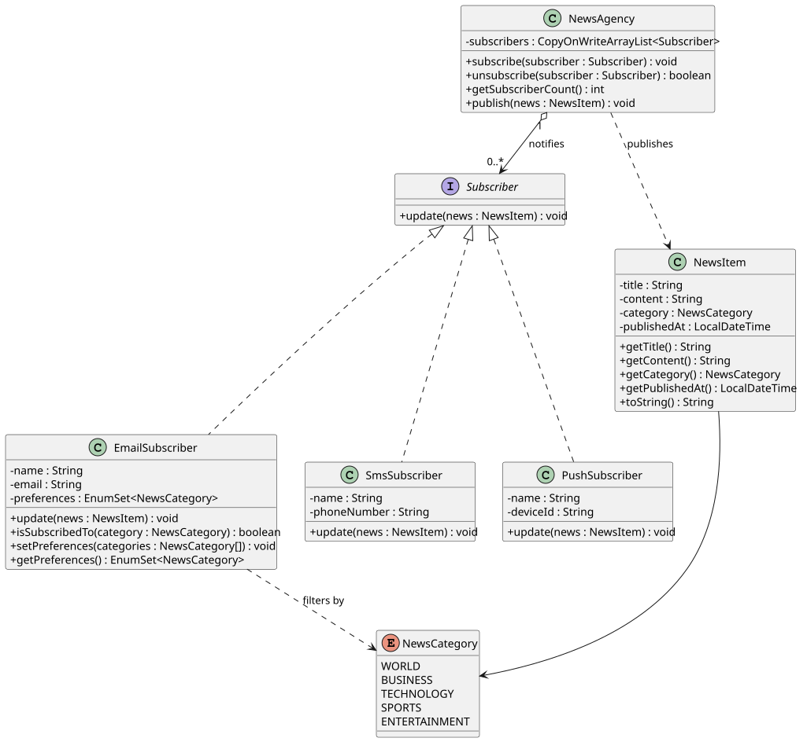

# Lab Assignment 6: Observer Pattern

**Real-time News Subscription Service**

**Course:** CCS311-18/CSL311-18
**Author:** Alexander Campita

## Problem Statement

**Real-time News Subscription Service**

**Background:** You're tasked with designing a real-time news subscription service for a media company. The system needs to notify subscribers about breaking news as soon as it's published by the news agency.

**Scenario Description:** The system comprises two main components: `NewsAgency` and `Subscriber`.

- **NewsAgency:** Represents the central hub for publishing news. It maintains a list of subscribers and notifies them whenever new news is available.
- **Subscriber:** Represents users or entities subscribed to the news service. Subscribers receive immediate notifications about any breaking news published by the agency.

**Requirements:**

- **Subscription Management:**
  - Users should be able to subscribe to the news service.
  - Subscribers should be notified promptly when new news is published.
- **Dynamic Subscription Updates:**
  - The system should allow for dynamic subscription updates. Subscribers can subscribe, unsubscribe, or modify their preferences without disrupting other subscribers.
- **Decoupled Communication:**
  - Ensure that the communication between the news agency and subscribers is decoupled. Subscribers shouldn't directly request news updates but should be notified by the news agency when new information is available.

**Expected Behavior:**

- When the news agency publishes breaking news, all subscribed users should receive immediate updates.
- Subscribers can join or leave the service without affecting the delivery of news to other subscribers.
- The system should provide flexibility for future enhancements, such as personalized subscriptions or categorization of news updates.

**Constraints:**

- The system should be scalable to handle a growing number of subscribers without compromising performance.
- Ensure that the implementation follows object-oriented design principles and promotes loose coupling between the news agency and subscribers.

## UML Class Diagram



PlantUML source: [docs/class-diagram.puml](docs/class-diagram.puml)

To regenerate the diagram:

```bash
java -jar plantuml.jar -tsvg docs/class-diagram.puml
```

## Design Summary

- `NewsAgency` is the **subject**. It stores subscribers and broadcasts every published `NewsItem`; it never references a concrete subscriber type.
- `Subscriber` is the **observer interface**. Concrete subscribers (`EmailSubscriber`, `SmsSubscriber`, `PushSubscriber`) implement `update(NewsItem)` and are notified without polling the agency.
- Communication is **decoupled**: the agency only knows the interface, and subscribers never request news themselves.
- **Dynamic updates:** `subscribe` and `unsubscribe` work at runtime. Duplicate subscriptions are ignored, and `CopyOnWriteArrayList` keeps iteration safe if the subscriber list changes during a broadcast.
- **Preferences:** `EmailSubscriber` filters by `NewsCategory` and supports changing preferences at runtime. New categories or subscriber types can be added without modifying `NewsAgency`.
- **Scalability:** notifications are a single linear pass over the subscriber list, and the thread-safe list supports concurrent subscription changes.

## Project Structure

```
observer-pattern/
├── README.md
├── docs/
│   ├── class-diagram.puml
│   ├── class-diagram.png
│   └── class-diagram.svg
└── src/newsservice/
    ├── EmailSubscriber.java
    ├── NewsAgency.java
    ├── NewsCategory.java
    ├── NewsItem.java
    ├── NewsServiceDemo.java
    ├── ObserverPatternTest.java
    ├── PushSubscriber.java
    ├── SmsSubscriber.java
    └── Subscriber.java
```

## How to Compile and Run

Requires JDK 8 or newer.

```bash
# From the project root
javac -d out src/newsservice/*.java
java -cp out newsservice.NewsServiceDemo
```

Run the automated checks:

```bash
java -cp out newsservice.ObserverPatternTest
```

Expected: `All ObserverPatternTest checks passed.`

## Sample Output

```text
Subscribers after sign-up: 3
Breaking news for 3 subscriber(s): [TECHNOLOGY] New AI model released - A local lab released an open-source language model.
[Email] Alex <alex@example.com> received: [TECHNOLOGY] New AI model released - A local lab released an open-source language model.
[SMS] Bianca (+63 917 000 0000) received: [TECHNOLOGY] New AI model released - A local lab released an open-source language model.
[Push] Caleb (device-001) received: [TECHNOLOGY] New AI model released - A local lab released an open-source language model.
Subscribers after Bianca unsubscribes: 2
Breaking news for 2 subscriber(s): [BUSINESS] Central bank holds rates - The central bank kept interest rates unchanged.
[Email] Alex <alex@example.com> received: [BUSINESS] Central bank holds rates - The central bank kept interest rates unchanged.
[Push] Caleb (device-001) received: [BUSINESS] Central bank holds rates - The central bank kept interest rates unchanged.
Breaking news for 2 subscriber(s): [SPORTS] National team wins - The national football team won the regional final.
[Push] Caleb (device-001) received: [SPORTS] National team wins - The national football team won the regional final.
```

## Requirement Mapping

| Requirement | Implementation |
| --- | --- |
| Subscribe and notify | `NewsAgency.subscribe(Subscriber)` and `publish(NewsItem)` |
| Unsubscribe without affecting others | `NewsAgency.unsubscribe(Subscriber)`; remaining subscribers still notified |
| Modify preferences | `EmailSubscriber.setPreferences(...)`; filtering happens per subscriber |
| Decoupled communication | Agency depends only on the `Subscriber` interface; subscribers are push-notified |
| Categorization / future enhancement | `NewsCategory` enum and preference-aware subscribers |
| Scalability | Single broadcast pass over a `CopyOnWriteArrayList` |

## Verification

`ObserverPatternTest` checks:

1. Subscribing the same subscriber twice does not duplicate notifications.
2. Publishing notifies every subscribed observer exactly once.
3. Unsubscribing stops delivery to that observer only.
4. Preference changes add and remove matching categories correctly.
